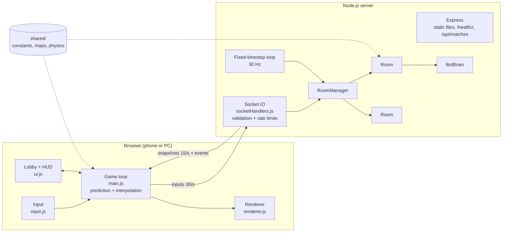
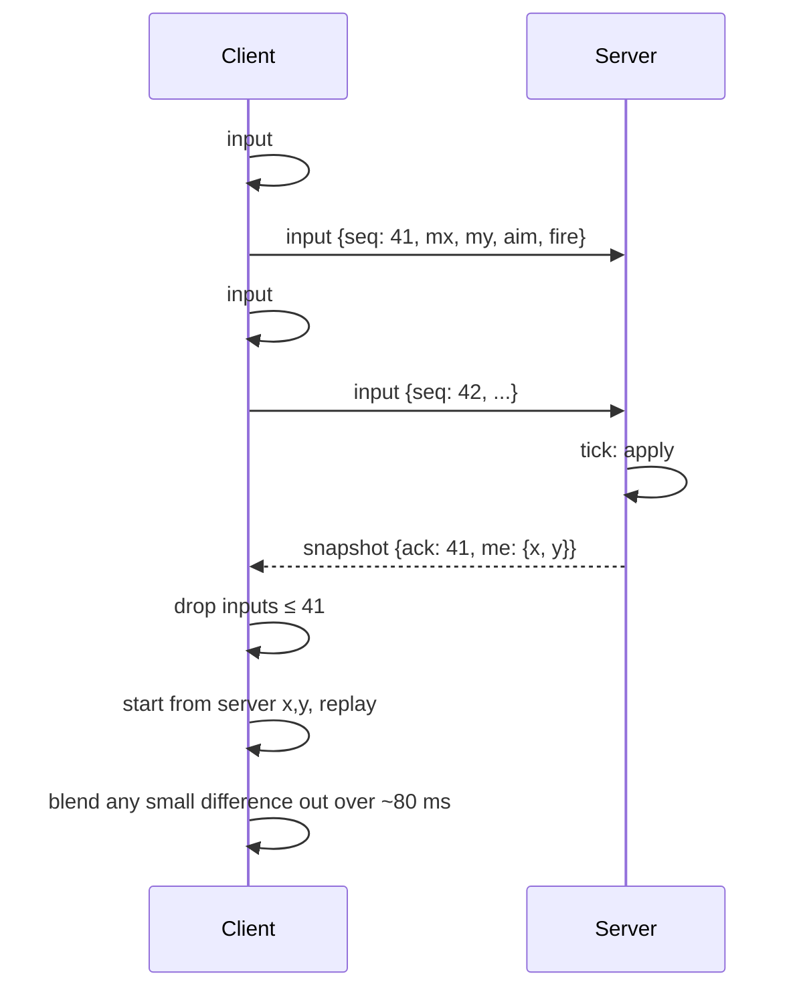

# 03 · System Design

## 1. Architecture overview

Maze Brawl is a **client–server** system with an **authoritative server**.



### Layers

| Layer | Files | Responsibility |
|---|---|---|
| Presentation | `public/js/ui.js`, `renderer.js`, `css/style.css` | DOM and canvas drawing only, no rules |
| Client logic | `public/js/main.js`, `input.js` | Input sampling, prediction, reconciliation, interpolation |
| Transport | `server/net/socketHandlers.js` | Socket events, validation, rate limits, broadcasting |
| Domain | `server/game/Room.js`, `RoomManager.js`, `BotBrain.js` | All game rules |
| Shared kernel | `shared/*.js` | Constants, maps and physics used by both sides |
| Infrastructure | `server/index.js`, `config.js`, `logger.js` | Boot, game loop, config, logging, shutdown |

`Room` has no knowledge of sockets. It reports what happened through an `onEvent` callback, which makes it fully unit-testable with a fake clock and seeded random numbers.

## 2. Key design decisions

| # | Decision | Alternatives considered | Reason |
|---|---|---|---|
| D1 | Authoritative server; clients send inputs only | Peer-to-peer (prototype), client-authoritative hits | Prevents cheating (NFR-1). The prototype could be cheated by editing the page. |
| D2 | Fixed timestep (1/30 s) with an accumulator | Variable `dt` from `setInterval` | Deterministic simulation; the client can replay inputs with the same `dt` for prediction. |
| D3 | Client-side prediction + reconciliation for the local player | Wait for server | Removes input lag (NFR-5). |
| D4 | Interpolate other players ~110 ms in the past | Extrapolation | Smooth motion without guessing; small fixed delay is acceptable for a casual shooter. |
| D5 | Shared ES modules served to the browser | Duplicate code, bundler | One source of truth for physics and tunables; no build step. |
| D6 | Socket.IO | Raw WebSocket, WebRTC | Reconnection, acknowledgements, rooms and polling fallback for restrictive networks. |
| D7 | In-memory rooms, single process | Redis / database | Matches are short-lived; nothing needs to persist in v1. Scaling path documented. |
| D8 | Bots run on the server through the same rules | Client-side bots | Bots behave identically for everyone and cannot be cheated. |

## 3. Netcode

### 3.1 Server loop

```
every ~16 ms:
  accumulator += elapsed (capped at 250 ms)
  while accumulator >= 33.3 ms:
      for each room: room.tick(1/30)
      every 2nd tick: send snapshot to every human in every room
```

### 3.2 Room tick order

1. Update round state (timer, end-of-round, restart)
2. For each player:
   - bots: `BotBrain.think()` → move/aim/fire intent
   - humans: apply up to 3 queued inputs (each = 1/30 s of movement)
   - fire if the trigger is held and the weapon cooldown has passed
3. Move projectiles in sub-steps of at most 12 px (no tunnelling through walls), apply hits and explosions
4. Respawn eliminated players whose timer has elapsed; check weapon pickups

### 3.3 Prediction and reconciliation



Because client and server run the same `moveEntity()` from `shared/physics.js` with the same `INPUT_DT`, the replayed position matches the server's unless something the client could not know happened (e.g. respawn).

### 3.4 Anti-cheat measures

| Threat | Countermeasure |
|---|---|
| Speed hack (large move vector) | Vector clamped to length 1 in `parseInput` |
| Speed hack (flooding inputs) | Max 10 queued inputs, max 3 applied per tick, 40 inputs/s rate limit |
| Replay / reorder | `seq` must strictly increase |
| Infinite ammo / health / damage | Not accepted from clients at all; computed on the server |
| Shooting faster | Cooldown enforced on the server clock |
| Script injection via name | Names sanitised server-side; all DOM output escaped client-side; CSP header |

## 4. Data model

### Player (server)
| Field | Type | Notes |
|---|---|---|
| id | string | Socket id, or `bot-N` |
| name, color, hat | string, string, int | Sanitised profile |
| team | 0, 1, 2 | 0 in deathmatch |
| x, y, angle | number | World pixels, radians |
| hp, alive | number, bool | |
| weapon, special, ammo | string, string?, int | `weapon` is what is in hand |
| kills, deaths | int | Reset each round |
| inputs, lastSeq | array, int | Input queue and last applied sequence number |

### Projectile
`{ id, kind: bullet|rocket|grenade, x, y, vx, vy, ownerId, team, weapon, damage, life, radius?, fuse?, moveLeft? }`

### Room
`{ code, mode, mapKey, visibility, botsEnabled, players: Map, projectiles[], pickups[], teamScores, round: { number, state: playing|ended, endsAt, stateEndsAt, winner } }`

## 5. Map format

Maps are 32 × 22 tiles of 48 px. Each map is authored as its left 16 columns and mirrored. Legend: `.` floor, `#` hedge, `o` rock, `B` building, `c` car, `A`/`H`/`R`/`G` weapon spawns. The border is forced solid.

## 6. Security headers

`Content-Security-Policy` (self-only scripts, Google Fonts styles/fonts, websocket connect), `X-Content-Type-Options: nosniff`, `X-Frame-Options: SAMEORIGIN`, `Referrer-Policy: no-referrer`; `x-powered-by` disabled.
